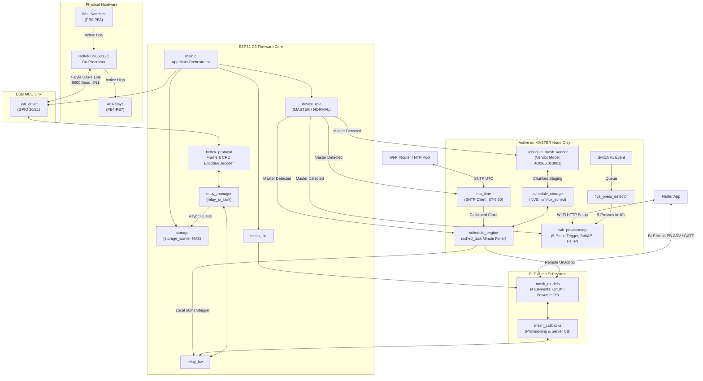
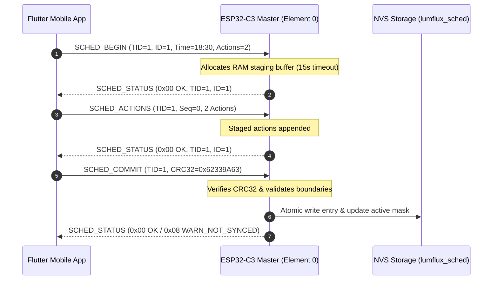

# Lumflux Smart Home System — ESP32-C3 BLE Mesh Firmware

[](https://www.espressif.com/en/products/socs/esp32-c3)
[](https://github.com/espressif/esp-idf)
[](docs/schedule_protocol.md)
[](#)

---

## Table of Contents

- [1. Overview and Features](#1-overview-and-features)
  - [What is Lumflux?](#what-is-lumflux)
  - [Dual-MCU Architecture](#dual-mcu-architecture)
  - [Key Firmware Features](#key-firmware-features)
- [2. Hardware Architecture & Pin Mapping](#2-hardware-architecture--pin-mapping)
  - [Microcontrollers](#microcontrollers)
  - [Inter-MCU UART Connection](#inter-mcu-uart-connection)
  - [Complete GPIO & Pin Assignment Table](#complete-gpio--pin-assignment-table)
  - [Power Supply & Radio Surge Protection](#power-supply--radio-surge-protection)
  - [Supported Output Load Types](#supported-output-load-types)
- [3. Software Architecture](#3-software-architecture)
  - [System Architecture & Data Flow Diagram](#system-architecture--data-flow-diagram)
  - [Folder Structure](#folder-structure)
  - [Core Modules Breakdown](#core-modules-breakdown)
- [4. Bluetooth Low Energy (BLE) Mesh Design](#4-bluetooth-low-energy-ble-mesh-design)
  - [Mesh Roles & Provisioning](#mesh-roles--provisioning)
  - [Elements, Models & Composition Data](#elements-models--composition-data)
  - [Custom Schedule Vendor Model](#custom-schedule-vendor-model)
  - [AppKey Binding & Addressing Schemes](#appkey-binding--addressing-schemes)
  - [NVS Persistence & Power-Cycle Recovery](#nvs-persistence--power-cycle-recovery)
- [5. Wi-Fi Provisioning Flow (Master Node)](#5-wi-fi-provisioning-flow-master-node)
  - [5-Press Mechanical Switch Trigger](#5-press-mechanical-switch-trigger)
  - [SoftAP Configuration & Captive Web Server](#softap-configuration--captive-web-server)
  - [HTTP REST Endpoints](#http-rest-endpoints)
  - [Credential Storage & Handover to STA](#credential-storage--handover-to-sta)
  - [Automatic Reconnection & Exponential Backoff](#automatic-reconnection--exponential-backoff)
- [6. Time Synchronization & Autonomous Scheduling](#6-time-synchronization--autonomous-scheduling)
  - [NTP Wall-Clock Synchronization (IST)](#ntp-wall-clock-synchronization-ist)
  - [Offline Timekeeping via Internal RTC](#offline-timekeeping-via-internal-rtc)
  - [Schedule Data Model & Limits](#schedule-data-model--limits)
  - [Repeat Types & Calendar Rules](#repeat-types--calendar-rules)
  - [Execution Engine, Deduplication & Rollover Rules](#execution-engine-deduplication--rollover-rules)
  - [Local vs. Remote Mesh Command Execution](#local-vs-remote-mesh-command-execution)
- [7. Schedule Protocol Wire Specification](#7-schedule-protocol-wire-specification)
  - [Vendor Message Summary Table](#vendor-message-summary-table)
  - [Chunked Upload Transaction Flow](#chunked-upload-transaction-flow)
  - [Protocol Documentation Link](#protocol-documentation-link)
- [8. Build, Flash, and Monitor](#8-build-flash-and-monitor)
  - [Prerequisites & ESP-IDF v6.0.1 Toolchain](#prerequisites--esp-idf-v601-toolchain)
  - [Build and Flash Commands](#build-and-flash-commands)
  - [Kconfig Project Configuration Options](#kconfig-project-configuration-options)
  - [Partition Table & Memory Layout](#partition-table--memory-layout)
  - [First-Time Flash & Erase Guide](#first-time-flash--erase-guide)
- [9. Testing and Diagnostics](#9-testing-and-diagnostics)
  - [Host Unit Test Suites](#host-unit-test-suites)
  - [Console Logging & Diagnostic Tags](#console-logging--diagnostic-tags)
  - [Boot Diagnostics & Heap Profiling](#boot-diagnostics--heap-profiling)
  - [Soak Testing & Field Checklist](#soak-testing--field-checklist)
- [10. Troubleshooting & Known Limitations](#10-troubleshooting--known-limitations)
  - [Troubleshooting Common Issues](#troubleshooting-common-issues)
  - [Known Limitations](#known-limitations)
- [11. Repository Structure, Contributing & Version Compatibility](#11-repository-structure-contributing--version-compatibility)
  - [Version Compatibility Matrix](#version-compatibility-matrix)
  - [Contributing Guidelines](#contributing-guidelines)
  - [License & Credits](#license--credits)
- [12. Unverified Items / TODO](#12-unverified-items--todo)

---

## 1. Overview and Features

### What is Lumflux?
**Lumflux** is a Bluetooth Low Energy (BLE) Mesh smart home automation ecosystem designed for decentralized lighting and appliance control. A Flutter mobile application provisions and controls nodes across rooms, scenes, and automated schedules.

In a Lumflux mesh network:
- Standard mesh nodes execute physical relay switching and listen for BLE Mesh commands.
- One designated node operates as the **MASTER node**. The Master connects to local 2.4 GHz Wi-Fi, synchronizes wall-clock time via NTP (India Standard Time, UTC+5:30), stores complex recurring schedules in Non-Volatile Storage (NVS), and autonomously executes them across the entire mesh network — **even when smartphones are disconnected, the mobile app is closed, and external cloud servers are unreachable**.

### Dual-MCU Architecture
To guarantee absolute reliability, real-time safety, and zero lag on physical wall switches, the Lumflux node uses a **dual-MCU co-processor hardware design**:

1. **ESP32-C3 Host MCU (RISC-V 32-bit):**
   - Manages the Bluetooth Low Energy Mesh stack (ESP-BLE-MESH with Bluedroid).
   - Hosts 4 BLE Mesh elements (one per relay channel) supporting Generic OnOff and Generic Power OnOff models.
   - On the Master node: runs Wi-Fi SoftAP provisioning, embedded HTTP server, SNTP client, and the autonomous scheduler engine.
   - Communicates with the co-processor over a robust 9600-baud UART protocol with checksum verification.
2. **Holtek BS86D12C Co-Processor MCU (8-bit):**
   - Scans 4 physical wall switches with 30 ms contact debounce.
   - Drives 4 independent relay driver outputs (PB4–PB7).
   - Eliminates switch lag or missed clicks while the ESP32-C3 handles intensive radio encryption or flash writes.
   - Seamlessly supports both momentary push-buttons (bell press) and standard maintained rocker wall switches.

```
+----------------------------------------------------------------------------------------------------+
|                                    LUMFLUX DUAL-MCU NODE                                           |
|                                                                                                    |
|   +------------------------------------+             +-----------------------------------------+   |
|   |          ESP32-C3 HOST             |             |       HOLTEK BS86D12C CO-PROCESSOR      |   |
|   |                                    |  UART Link  |                                         |   |
|   |  - ESP-BLE-MESH Stack (4 Elements) |  9600 Baud  |  - 30ms Physical Switch Debounce        |   |
|   |  - Master Vendor Model (0x02E5)   |<===========>|  - Direct Relay Output Drivers (Ch 1-4) |   |
|   |  - Wi-Fi SoftAP & Captive Server   |  GPIO 21/20 |  - Rocker & Momentary Button Support    |   |
|   |  - NTP Timekeeping (IST UTC+5:30)  |  (4 Bytes)  |  - Boot Handshake State Sync            |   |
|   |  - Autonomous Scheduler Engine     |             |                                         |   |
|   +------------------------------------+             +-----------------------------------------+   |
|                     ^                                                ^             |               |
+---------------------|------------------------------------------------|-------------|---------------+
                      | BLE Mesh RF                                    |             v
                      v                                                |        [4x Relays]
         [Mobile App / Mesh Nodes]                           [4x Wall Switches] (PB4 - PB7)
```

### Key Firmware Features
- **Decentralized BLE Mesh Control:** Full compliance with Bluetooth SIG Mesh Profile v1.0.1. Supports PB-ADV and PB-GATT provisioning, GATT Proxy, and Relay features.
- **Dynamic Device Role Detection:** Automatically detects whether it is running on a custom PCB with a Holtek co-processor (`NORMAL_NODE`) or standalone hardware such as an ESP32-C3-DevKitM-1 (`MASTER`). Role can be overridden via `Kconfig`.
- **Zero-Cloud Autonomous Scheduling:** The Master node stores up to 16 multi-target schedules in NVS. Actions are evaluated minute-by-minute and dispatched across local relays and remote mesh nodes without internet reliance.
- **5-Press Wi-Fi Setup Trigger:** Pressing the first physical wall switch (or DevKit BOOT button) 5 times enters SoftAP provisioning mode (`lumflux_device` at `192.168.4.1`) with a self-contained HTML/JSON setup portal.
- **NTP Timekeeping & Power-Loss Recovery:** Calibrates internal RTC to India Standard Time (`IST-5:30`). Persists epoch benchmarks to NVS every 15 minutes. Automatically recovers schedule execution upon power restoration.
- **Deduplication & Collision Avoidance:** Staggers local relay switching by 50 ms to prevent UART buffer overrun. If multiple schedules trigger concurrently, the highest schedule ID wins (`Last Action Wins`).
- **Reboot Persistence Hardening:** Solves standard Bluedroid alarm pool starvation by allocating 100 hardware/software timers (`CONFIG_BT_ALARM_MAX_NUM=100`), ensuring mesh keys and sequences persist across power cycles.

---

## 2. Hardware Architecture & Pin Mapping

### Microcontrollers
- **Host MCU:** Espressif ESP32-C3FH4 / ESP32-C3FN4 / ESP8685 (32-bit RISC-V core @ up to 160 MHz, 400 KB SRAM, 4 MB / 2 MB embedded flash).
- **Co-Processor MCU:** Holtek BS86D12C (8-bit RISC core @ 8 MHz internal RC oscillator, 2.2V–5.5V operating voltage).

### Inter-MCU UART Connection
Communication between the ESP32-C3 host and Holtek co-processor uses UART1 at **9600 Baud, 8 Data Bits, No Parity, 1 Stop Bit (8N1)**.

| ESP32-C3 Host Pin | Signal Direction | Holtek BS86D12C Pin | Function Description |
| :--- | :---: | :--- | :--- |
| **GPIO 21** | ESP32 TX → Holtek RX | UART RX | Commands from ESP32 to co-processor |
| **GPIO 20** | ESP32 RX ← Holtek TX | UART TX | Switch events and execution ACKs |
| **GND** | ↔ | **GND** | **Common Ground (Mandatory for noise immunity)** |

### Complete GPIO & Pin Assignment Table

#### ESP32-C3 Pin Allocations
| GPIO Pin | Direction | Type | Function / Description |
| :--- | :---: | :---: | :--- |
| **GPIO 3** | Output | Push-Pull | Red Status LED (`LED_R`) |
| **GPIO 4** | Output | Push-Pull | Green Status LED (`LED_G`): Solid ON = Unprovisioned / Advertising; OFF = Provisioned |
| **GPIO 5** | Output | Push-Pull | Blue Status LED (`LED_B`) |
| **GPIO 9** | Input | Pull-Up | DevKit BOOT button / Direct Switch #1 input (`CONFIG_WIFI_PROV_SWITCH_GPIO`) |
| **GPIO 20** | Input | Pull-Up | UART1 RX (Receives packets from Holtek co-processor) |
| **GPIO 21** | Output | Push-Pull | UART1 TX (Transmits packets to Holtek co-processor) |

#### Holtek BS86D12C Pin Allocations
| Pin Name | Direction | Default State | Connected Hardware |
| :--- | :---: | :---: | :--- |
| **PB0** | Input | Internal Pull-Up | Physical Switch #1 (Active LOW to GND, 30ms debounce) |
| **PB1** | Input | Internal Pull-Up | Physical Switch #2 (Active LOW to GND, 30ms debounce) |
| **PB2** | Input | Internal Pull-Up | Physical Switch #3 (Active LOW to GND, 30ms debounce) |
| **PB3** | Input | Internal Pull-Up | Physical Switch #4 (Active LOW to GND, 30ms debounce) |
| **PB4** | Output | Low | Relay 1 Driver (Active HIGH = Relay ON) |
| **PB5** | Output | Low | Relay 2 Driver (Active HIGH = Relay ON) |
| **PB6** | Output | Low | Relay 3 Driver (Active HIGH = Relay ON) |
| **PB7** | Output | Low | Relay 4 Driver (Active HIGH = Relay ON) |

### Power Supply & Radio Surge Protection
The ESP32-C3 incorporates both Bluetooth LE and 2.4 GHz Wi-Fi radios. During Wi-Fi calibration and packet transmission, instantaneous peak currents can reach 350–500 mA.

> [!IMPORTANT]
> **Radio Surge Mitigation:** To prevent brownout resets (`ESP_RST_BROWNOUT`), the firmware enforces a strictly staggered boot order:
> 1. BLE Mesh stack initializes first and stabilizes radio advertising (`mesh_init()`).
> 2. Wi-Fi autoconnect is intentionally delayed by **8,000 ms** (`CONFIG_WIFI_BOOT_DELAY_MS`).
> 3. Ensure a minimum 10 µF ceramic capacitor and 100 µF bulk electrolytic capacitor are placed near the ESP32-C3 3.3V rail.

### Supported Output Load Types
- **Relay 1 to 4 Outputs:** Compatible with standard mechanical relay coils (driven via ULN2003 or discrete NPN/MOSFET stages).
- **Lamps & Resistive Loads:** Incandescent, halogen, and dimmable/non-dimmable LED drivers.
- **Fans & Inductive Loads:** Ceiling fans, exhaust fans, and inductive motor coils (snubber circuit recommended across relay contacts).
- **Curtains / KTH / Corridor:** Supported within the broader Lumflux mesh protocol. *TODO: confirm dedicated firmware profiles for curtain motors or KTH sensors in this build.*

---

## 3. Software Architecture

### System Architecture & Data Flow Diagram



### Folder Structure
```
Ble_Mesh_project/
├── ble_mesh_node/                     <-- ESP32-C3 Host Firmware (ESP-IDF v6.0.1)
│   ├── CMakeLists.txt                 <-- Project root CMake build definition
│   ├── dependencies.lock              <-- ESP Component Manager lock file
│   ├── sdkconfig                      <-- Active project configuration
│   ├── sdkconfig.defaults             <-- Baseline config defaults
│   ├── sdkconfig.defaults.esp32c3     <-- Target-specific overrides (BT alarms, timeouts)
│   ├── docs/
│   │   └── schedule_protocol.md       <-- Detailed vendor model wire protocol specification
│   ├── components/
│   │   ├── holtek_protocol/           <-- 4-byte UART packet framing and checksum verification
│   │   ├── relay_manager/             <-- Relay state machine, UART RX task, ACK retry engine
│   │   └── uart_driver/               <-- Ring-buffered UART1 driver on GPIO 20/21
│   └── main/
│       ├── CMakeLists.txt             <-- Main component registration and sources
│       ├── Kconfig.projbuild          <-- Project menuconfig definitions
│       ├── main.c                     <-- Boot sequence orchestrator and diagnostics
│       ├── common/
│       │   ├── board.c                <-- Status LED GPIO driver and state tracking
│       │   └── board.h
│       ├── mesh/
│       │   ├── mesh_init.c            <-- Bluetooth LE controller and ESP-BLE-MESH stack init
│       │   ├── mesh_models.c          <-- Composition data, elements, and SIG server models
│       │   ├── mesh_provisioning.c    <-- Device UUID generator (from Bluetooth MAC)
│       │   └── mesh_callbacks.c       <-- Provisioning and generic server event handlers
│       ├── moduls/                    <-- Master node scheduling & provisioning subsystems
│       │   ├── device_role.c          <-- Master vs Normal node detection via Holtek probe
│       │   ├── five_press_detector.c  <-- Pure mathematical 5-press detector state machine
│       │   ├── ntp_time.c             <-- SNTP time synchronization and IST POSIX timezone
│       │   ├── schedule_model.c       <-- Schedule data structures and CRC32 calculations
│       │   ├── schedule_storage.c     <-- NVS CRUD operations for schedule entries
│       │   ├── schedule_engine.c      <-- Background minute-rollover scheduler execution task
│       │   ├── schedule_mesh_vendor.c <-- Vendor model server and chunked upload staging
│       │   ├── wifi_provisioning.c    <-- SoftAP portal, embedded web server, and STA backoff
│       │   ├── test_five_press_detector.c <-- Host unit test runner for 5-press detector
│       │   ├── test_schedule_protocol.c   <-- Host unit test runner for vendor protocol
│       │   └── test_rtc_timekeeping.c     <-- Host unit test runner for clock and scheduler
│       ├── relay/
│       │   └── relay_hw.c             <-- Hardware abstraction layer connecting mesh to relay_manager
│       └── storage/
│           └── storage.c              <-- Asynchronous NVS persistence worker for relay states
├── retrofit_V2/                       <-- Holtek BS86D12C Co-Processor Firmware
│   ├── retrofit_V2.c                  <-- Holtek C code (switch debounce, relay output, UART)
│   ├── retrofit_V2.pjt                <-- Holtek HT-IDE3000 / WICE project file
│   └── startup1_l.asm                 <-- Compiler C runtime startup assembly
└── Mesh_Control_App/                  <-- Flutter Companion App (Lumflux Swift App)
```

### Core Modules Breakdown

| Module | Files | Public API Entry Points | FreeRTOS Tasks & Queues | NVS Namespace & Keys |
| :--- | :--- | :--- | :--- | :--- |
| **`device_role`** | `device_role.c/h` | `device_role_init()`, `device_role_get()`, `device_role_is_master()` | Synchronous UART probe at boot | Namespace: `"device_role"`<br>Key: `"role"` |
| **`wifi_provisioning`** | `wifi_provisioning.c/h` | `wifi_init()`, `wifi_prov_post_switch_event()`, `wifi_prov_start_provisioning()` | Queue: `s_switch_queue`<br>Timer: `s_backoff_timer`<br>Task: `httpd` worker | Namespace: `"lumflux_wifi"`<br>Key: `"credentials"` (SSID, pass, CRC32) |
| **`ntp_time`** | `ntp_time.c/h` | `ntp_time_init()`, `ntp_time_is_synced()`, `ntp_time_get_ist()` | lwIP SNTP background client<br>Timer: `s_sntp_delay_timer` | Namespace: `"ntp_time"`<br>Key: `"last_epoch"` |
| **`scheduler`** | `schedule_engine.c/h`<br>`schedule_storage.c/h`<br>`schedule_mesh_vendor.c/h` | `sched_engine_init()`, `sched_engine_run_now()`, `schedule_mesh_vendor_init()` | Task: `sched_task` (Priority 3, 4 KB stack)<br>Mutex: `s_storage_mutex`, `s_engine_mutex` | Namespace: `"lumflux_sched"`<br>Keys: `"mask"` (uint16 bitmask), `"sc_%02x"` (blobs) |
| **`relay_manager`** | `relay_manager.c/h` | `relay_manager_init()`, `relay_manager_set_state()` | Task: `relay_rx_task` (Priority 4, 4 KB stack)<br>Mutex: `relay_mutex` | Handled via `storage.c` |
| **`storage`** | `storage.c/h` | `storage_init()`, `save_relay_state()`, `load_power_up_state()` | Task: `storage_worker` (Priority 5, 3 KB stack)<br>Queue: `storage_queue` (depth 16) | Namespace: `"storage"`<br>Keys: `"relay_%d"`, `"power_up_%d"` |

---

## 4. Bluetooth Low Energy (BLE) Mesh Design

### Mesh Roles & Provisioning
- **Device Provisioning Roles:** Supports **PB-ADV** (advertising bearer) and **PB-GATT** (GATT proxy bearer).
- **Relay & Proxy Feature:** Configured as a GATT Proxy Server and Mesh Relay with default TTL = 7 and network retransmit count = 2 (20 ms interval).
- **Device UUID Construction:** Generated automatically at startup from the Bluetooth MAC address according to RFC 4122 v1:
  - Byte 6 = `0x10` (Version 1)
  - Byte 8 = `0x80` (Variant 1)
  - Bytes 10..15 = ESP32-C3 Bluetooth MAC address

### Elements, Models & Composition Data
The node registers **4 elements**, corresponding directly to Relay channels 1 through 4:

| Element Index | Element Role | SIG Standard Models | Vendor Custom Models | Output Mapping |
| :---: | :--- | :--- | :--- | :--- |
| **Element 0** | Primary Element | - Config Server (`0x0000`)<br>- Health Server (`0x0002`)<br>- Generic OnOff Server (`0x1000`)<br>- Generic Power OnOff Server (`0x1006`)<br>- Generic Power OnOff Setup Server (`0x1007`) | **Schedule Management Model**<br>- Company ID: `0x02E5`<br>- Model ID: `0x0001` *(Master only)* | **Relay 1** (PB4) |
| **Element 1** | Secondary Element | - Generic OnOff Server (`0x1000`)<br>- Generic Power OnOff Server (`0x1006`)<br>- Generic Power OnOff Setup Server (`0x1007`) | *None* | **Relay 2** (PB5) |
| **Element 2** | Secondary Element | - Generic OnOff Server (`0x1000`)<br>- Generic Power OnOff Server (`0x1006`)<br>- Generic Power OnOff Setup Server (`0x1007`) | *None* | **Relay 3** (PB6) |
| **Element 3** | Secondary Element | - Generic OnOff Server (`0x1000`)<br>- Generic Power OnOff Server (`0x1006`)<br>- Generic Power OnOff Setup Server (`0x1007`) | *None* | **Relay 4** (PB7) |

### Custom Schedule Vendor Model
- **Company Identifier (CID):** `0x02E5` (Espressif Systems B.V.).
- **Model Identifier:** `0x0001`.
- **Location:** Bound exclusively to **Element 0** when `CONFIG_VENDOR_MODEL_ENABLE` is enabled.
- **Publication Context:** Buffer sized for `3 + 64` bytes to transmit full schedule metadata and status frames.

### AppKey Binding & Addressing Schemes
During provisioning by the Lumflux Swift App:
1. The Provisioner assigns the primary element a 16-bit Unicast Address (e.g., `0x0005`).
2. Elements 1, 2, and 3 automatically take consecutive addresses (`0x0006`, `0x0007`, `0x0008`).
3. Application Key (`AppKey Index 0x0000`) must be bound to:
   - All Generic OnOff Servers (`0x1000`) across Elements 0–3.
   - The Schedule Vendor Model (`0x02E5:0x0001`) on Element 0.

### NVS Persistence & Power-Cycle Recovery
Standard Bluedroid and ESP-BLE-MESH configurations frequently lose provisioning data after power loss due to alarm timer exhaustion. This firmware applies three critical fixes:

1. **Alarm Pool Expansion (`CONFIG_BT_ALARM_MAX_NUM=100`):**
   The complex 4-element composition requires ~49 timer alarms before the mesh settings module initializes. Expanding the pool from 50 to 100 guarantees that settings timers succeed.
2. **Immediate Flash Store (`CONFIG_BLE_MESH_STORE_TIMEOUT=0`):**
   Forces NetKey, AppKey, IV Index, and model publication bindings to write to NVS immediately upon assignment.
3. **Power-Up State Restoration:**
   Each relay restores its state on power-up according to Generic Power OnOff settings:
   - `0x00`: Always initialize OFF.
   - `0x01`: Always initialize ON.
   - `0x02`: Restore last known state from NVS before reboot (Default).

---

## 5. Wi-Fi Provisioning Flow (Master Node)

### 5-Press Mechanical Switch Trigger
To enter Wi-Fi setup mode without requiring dedicated physical buttons or mobile Bluetooth scanning:
- Press **Switch #1** (or DevKit GPIO 9 BOOT button) **5 times** consecutively.
- **Timing Constraints:**
  - Contact bounce filter: 40 ms threshold (`CONFIG_WIFI_PROV_DEBOUNCE_MS`).
  - Maximum gap between consecutive presses: 1500 ms (`CONFIG_WIFI_PROV_PRESS_GAP_MS`).
  - Maximum total sequence duration: 10,000 ms (`CONFIG_WIFI_PROV_PRESS_WINDOW_MS`).
  - Any press on Switches 2, 3, or 4 instantly aborts the sequence.

### SoftAP Configuration & Captive Web Server
Once triggered, the Master node:
1. Initializes the Wi-Fi radio in `WIFI_MODE_APSTA` mode.
2. Broadcasts an open Wi-Fi Access Point:
   - **SSID:** `lumflux_device`
   - **Password:** *Open (None)*
   - **Gateway IP:** `192.168.4.1`
   - **Inactivity Timeout:** 300 seconds (automatically shuts down AP if no client interacts).

### HTTP REST Endpoints

| Method | URI | Request Body | Response Body | Description |
| :---: | :--- | :--- | :--- | :--- |
| `GET` | `/` | *None* | `text/html` | Self-contained, responsive HTML/JS portal for mobile browsers. |
| `GET` | `/scan` | *None* | `application/json` | Triggers 2.4 GHz active scan; returns visible SSIDs and RSSI levels. |
| `POST` | `/connect` | `{"ssid":"...","password":"..."}` | `application/json` | Saves credentials to NVS and initiates background router connection. |
| `GET` | `/status` | *None* | `application/json` | Returns status: `{"state":"...","ip":"...","reason":0}`. |

### Credential Storage & Handover to STA
- Submitted credentials are validated and written to NVS namespace `"lumflux_wifi"` as a binary blob accompanied by an IEEE 802.3 CRC32 checksum.
- Once connected with a valid IP, the web server displays:
  > *"Connected successfully! Wi-Fi settings are saved. You can now close this page and disconnect from lumflux_device."*
- After a **5-second grace period**, the SoftAP and HTTP server shut down completely, leaving the ESP32-C3 in pure Station mode with 802.11 modem sleep enabled.

### Automatic Reconnection & Exponential Backoff
If the Wi-Fi router reboots or drops out:
- The firmware enters an exponential backoff loop:
  $$\text{Delay (seconds)} = 1 \times 2^{\min(\text{retry\_count},\, 6)} \quad (1\text{s}, 2\text{s}, 4\text{s}, 8\text{s}, 16\text{s}, 32\text{s}, \text{max } 64\text{s})$$
- Retrying occurs silently in the background without blocking BLE Mesh operations.

---

## 6. Time Synchronization & Autonomous Scheduling

### NTP Wall-Clock Synchronization (IST)
- **Timezone:** Fixed to India Standard Time (`POSIX: "IST-5:30"`), UTC offset $+330$ minutes.
- **NTP Server:** `pool.ntp.org` (configurable via `CONFIG_SCHED_NTP_SERVER`).
- **Resynchronization:** SNTP client automatically starts upon obtaining an IP address (`WIFI_PROV_EVENT_GOT_IP`).
- The system persists the latest calibrated epoch to NVS namespace `"ntp_time"` every 15 minutes.

### Offline Timekeeping via Internal RTC
The ESP32-C3 internal hardware timer maintains fractional second accuracy across extended Wi-Fi outages:
- If Wi-Fi is lost indefinitely, schedules continue firing reliably based on internal timekeeping.
- If the device completely loses power without Wi-Fi, the scheduler engine remains safely paused until the first valid SNTP sync, preventing stale schedules from firing at random boot dates (e.g. 1970).

### Schedule Data Model & Limits
Schedules are stored in NVS namespace `"lumflux_sched"` under keys `"sc_%02x"`:

```c
typedef struct __attribute__((packed)) {
    uint8_t  id;                    /* 1 to 16 */
    uint8_t  version;               /* Protocol Version = 1 */
    uint8_t  enabled;               /* 1 = Active, 0 = Disabled */
    uint8_t  hour;                  /* 0 to 23 (IST) */
    uint8_t  minute;                /* 0 to 59 (IST) */
    uint8_t  repeat_type;           /* 0=ONCE, 1=DAILY, 2=WEEKDAYS, 3=WEEKENDS, 4=CUSTOM */
    uint8_t  repeat_days;           /* Bitmask for CUSTOM (bit 0=Sun ... bit 6=Sat) */
    uint16_t once_year;             /* Calendar year for ONCE (e.g. 2026) */
    uint8_t  once_month;            /* 1 to 12 */
    uint8_t  once_day;              /* 1 to 31 */
    char     name[16];              /* Null-padded ASCII label */
    uint8_t  action_count;          /* 1 to 8 */
    sched_action_t actions[8];      /* 4 bytes per action (Target, Kind, Value) */
    uint32_t crc32;                 /* CRC32 over the preceding 60 bytes */
} schedule_entry_t; /* Exactly 64 Bytes */
```

### Repeat Types & Calendar Rules
- `0 (SCHED_REPEAT_ONCE)`: Matches exact calendar Date + Time. Automatically sets `enabled = 0` in NVS upon execution.
- `1 (SCHED_REPEAT_DAILY)`: Evaluates every day at `hour:minute`.
- `2 (SCHED_REPEAT_WEEKDAYS)`: Monday through Friday (`tm_wday` 1 to 5).
- `3 (SCHED_REPEAT_WEEKENDS)`: Saturday and Sunday (`tm_wday` 0 and 6).
- `4 (SCHED_REPEAT_CUSTOM)`: Days active mapped by bitmask:
  - `Bit 0` = Sunday, `Bit 1` = Monday, `Bit 2` = Tuesday, `Bit 3` = Wednesday, `Bit 4` = Thursday, `Bit 5` = Friday, `Bit 6` = Saturday.

### Execution Engine, Deduplication & Rollover Rules
The scheduler task (`sched_task`) wakes up once per second:
1. **Clock Adjustment Safety:**
   - **Backward Adjustment (Clock Step Back):** Suppresses duplicate execution for the same minute.
   - **Forward Jump $\le 15$ min:** Catches up missed minutes sequentially so scheduled commands are never dropped.
   - **Forward Jump $> 15$ min:** Re-aligns cleanly without firing stale events.
2. **Conflict Deduplication (Last Action Wins):**
   If multiple schedules fire at the same minute targeting the same relay with opposing states, the actions merge and **the schedule with the highest ID executes**.

### Local vs. Remote Mesh Command Execution
- **Local Relays:** If the target matches Element 0..3 on the Master node, commands are dispatched to the Holtek co-processor spaced **50 ms apart** to avoid UART buffer overrun.
- **Remote Mesh Nodes:** If the target is a remote unicast address, the Master broadcasts a `Generic OnOff Set Unacknowledged` packet **3 times with a 20 ms gap and identical Transaction ID (TID)**. Remote nodes drop duplicates with the same TID.

---

## 7. Schedule Protocol Wire Specification

### Vendor Message Summary Table
Vendor opcodes use Company ID `0x02E5` and 3-byte wire encoding:

| 1-Byte Opcode | 3-Byte Mesh Opcode | Identifier | Direction | Payload Size | Purpose |
| :---: | :---: | :--- | :---: | :---: | :--- |
| `0x01` | `0xC102E5` | `SCHED_VND_OP_BEGIN` | App → Node | 29 bytes | Initiates chunked upload and header metadata |
| `0x02` | `0xC202E5` | `SCHED_VND_OP_ACTIONS` | App → Node | 3–19 bytes | Chunks of 1 to 4 actions (`target`, `kind`, `val`) |
| `0x03` | `0xC302E5` | `SCHED_VND_OP_COMMIT` | App → Node | 5 bytes | Finalizes upload with expected CRC32 |
| `0x04` | `0xC402E5` | `SCHED_VND_OP_DELETE` | App → Node | 2 bytes | Deletes schedule by ID |
| `0x05` | `0xC502E5` | `SCHED_VND_OP_ENABLE` | App → Node | 3 bytes | Enables or disables schedule |
| `0x06` | `0xC602E5` | `SCHED_VND_OP_CLEAR` | App → Node | 1 byte | Erases all schedules from NVS |
| `0x07` | `0xC702E5` | `SCHED_VND_OP_GET` | App → Node | 2 bytes | Queries single schedule entry by ID |
| `0x08` | `0xC802E5` | `SCHED_VND_OP_LIST` | App → Node | 1 byte | Requests count and active schedule bitmask |
| `0x09` | `0xC902E5` | `SCHED_VND_OP_RUN_NOW` | App → Node | 2 bytes | Immediately triggers schedule actions for testing |
| `0x0A` | `0xCA02E5` | `SCHED_VND_OP_TIME_GET` | App → Node | 1 byte | Requests clock calibration status and slot capacity |
| `0x0B` | `0xCB02E5` | `SCHED_VND_OP_STATUS` | Node → App | 3 bytes | Generic status response (`STATUS`, `TID`, `ID`) |
| `0x0C` | `0xCC02E5` | `SCHED_VND_OP_LIST_STATUS` | Node → App | 4 bytes | Active count and 16-bit bitmask reply |
| `0x0D` | `0xCD02E5` | `SCHED_VND_OP_TIME_STATUS` | Node → App | 11 bytes | Time sync validity, epoch, free slots reply |

### Chunked Upload Transaction Flow



### Protocol Documentation Link
For byte-level wire layouts, status codes, and message parsing rules, see the complete specification in:
👉 [docs/schedule_protocol.md](docs/schedule_protocol.md)

---

## 8. Build, Flash, and Monitor

### Prerequisites & ESP-IDF v6.0.1 Toolchain
- **OS:** Linux (Ubuntu 20.04/22.04 LTS recommended) / macOS / Windows WSL2.
- **ESP-IDF Version:** `v6.0.1` (Required for BLE Mesh API compatibility and compiler optimizations).

### Build and Flash Commands

```bash
# 1. Source the ESP-IDF v6.0.1 environment
. $HOME/esp/esp-idf/export.sh

# 2. Navigate to the firmware directory
cd Ble_Mesh_project/ble_mesh_node

# 3. Set the target chip to ESP32-C3
idf.py set-target esp32c3

# 4. Open configuration menu (optional)
idf.py menuconfig

# 5. Build the firmware binary
idf.py build

# 6. Flash to the ESP32-C3 and open serial monitor
idf.py -p /dev/ttyUSB0 flash monitor
```

### Kconfig Project Configuration Options

Key project-specific settings accessible via `idf.py menuconfig`:

| Kconfig Symbol | Default | Description |
| :--- | :---: | :--- |
| `CONFIG_DEVICE_ROLE_FORCE_MASTER` | `y` | Forces node to operate as Master, bypassing Holtek UART probe |
| `CONFIG_APP_BOOT_DEBUG` | `y` | Enables verbose boot diagnostics, heap tracking, and shutdown backtrace |
| `CONFIG_WIFI_PROV_AP_SSID` | `"lumflux_device"` | SoftAP broadcast SSID during Wi-Fi provisioning mode |
| `CONFIG_WIFI_PROV_AP_PASSWORD` | `""` | SoftAP password (leave empty for open setup network) |
| `CONFIG_WIFI_PROV_SWITCH_GPIO` | `9` | GPIO for BOOT button / Switch #1 direct trigger (-1 to disable) |
| `CONFIG_WIFI_PROV_PRESS_GAP_MS` | `1500` | Maximum gap between consecutive presses in ms |
| `CONFIG_WIFI_PROV_PRESS_WINDOW_MS`| `10000` | Maximum total sequence window in ms |
| `CONFIG_WIFI_BOOT_DELAY_MS` | `8000` | Staggered Wi-Fi radio boot delay to avoid brownout surge |
| `CONFIG_SCHED_TIMEZONE` | `"IST-5:30"` | POSIX timezone string for wall clock |
| `CONFIG_SCHED_NTP_SERVER` | `"pool.ntp.org"` | SNTP server hostname |
| `CONFIG_SCHED_MAX_COUNT` | `16` | Maximum schedules stored in NVS |
| `CONFIG_SCHED_MAX_ACTIONS` | `8` | Maximum actions per schedule |
| `CONFIG_BT_ALARM_MAX_NUM` | `100` | **Reboot persistence timer pool (must be $\ge 80$)** |

### Partition Table & Memory Layout
The project uses `partitions_singleapp_large.csv` targeting 2 MB / 4 MB flash:

```
# ESP-IDF Partition Table
# Name,   Type, SubType, Offset,  Size, Flags
nvs,      data, nvs,     0x9000,  0x6000,
phy_init, data, phy,     0xf000,  0x1000,
factory,  app,  factory, 0x10000, 0x1E0000,
```
- Single large factory application partition allows up to ~1.9 MB firmware size.

### First-Time Flash & Erase Guide
When flashing an unprovisioned board or resetting mesh configuration:
```bash
# Completely erase flash (erases NVS mesh keys, Wi-Fi credentials, and schedules)
idf.py -p /dev/ttyUSB0 erase-flash

# Flash bootloader, partition table, and application
idf.py -p /dev/ttyUSB0 flash monitor
```

---

## 9. Testing and Diagnostics

### Host Unit Test Suites
Unit tests are implemented with zero hardware dependencies and can be compiled and executed directly on any Linux/macOS host:

```bash
# Navigate to the modules folder
cd Ble_Mesh_project/ble_mesh_node/main/moduls

# 1. Run 5-Press Detector Unit Tests (71 checks)
gcc -Wall -Wextra -std=c99 -I. test_five_press_detector.c five_press_detector.c -o test_five_press_detector
./test_five_press_detector

# 2. Run BLE Mesh Schedule Protocol Unit Tests (60 checks)
gcc -Wall -Wextra -std=c99 -I. test_schedule_protocol.c schedule_model.c -o test_schedule_protocol
./test_schedule_protocol

# 3. Run RTC Timekeeping, NTP & Outage Recovery Tests (47 checks)
gcc -Wall -Wextra -std=c99 -I. test_rtc_timekeeping.c schedule_model.c -o test_rtc_timekeeping
./test_rtc_timekeeping
```

### Console Logging & Diagnostic Tags

| Log Tag | Component | Key Diagnostic Messages |
| :--- | :--- | :--- |
| `MAIN` | System Orchestrator | `Reset Reason`, `Boot Baseline Heap`, `[BOOT_STAGE]` progress |
| `DEVICE_ROLE` | Role Classifier | `Forced MASTER role active`, `Detected NORMAL_NODE via Holtek ACK` |
| `wifi_prov` | Wi-Fi Provisioning | `[PROV_START] Baseline Free heap`, `5-press detected`, `Connected successfully` |
| `NTP_TIME` | Clock System | `Time synchronized via SNTP`, `IST Time: YYYY-MM-DD HH:MM:SS` |
| `SCHED_ENGINE` | Scheduler Worker | `Initial minute evaluated`, `Catch-up evaluate minute`, `Clock stepped forward` |
| `SCHED_STORAGE`| NVS Storage | `Loaded schedule active mask`, `Atomic commit verified with CRC32` |
| `SCHED_VENDOR` | Vendor Model | `Allocated staging buffer`, `CRC mismatch error`, `Rate limit dropped` |
| `MESH_INIT` | BLE Mesh Init | `Bluetooth Mesh Stack Ready`, `[COMPOSITION]` data dump |
| `MESH_CALLBACKS`| BLE Mesh Events | `Provisioning data persisted in NVS`, `OnOff Set received` |
| `RELAY_MGR` | Relay Machine | `UART0 TX ->`, `UART0 RX <-`, `Relay%d OUT_OF_SYNC` |

### Boot Diagnostics & Heap Profiling
At startup, `main.c` logs memory checkpoints across every subsystem:
```text
I (310) MAIN: ================================================
I (315) MAIN: [MESH] === BLE MESH NODE BOOT DIAGNOSTICS ===
I (320) MAIN: [MESH] ESP-IDF Version : v6.0.1
I (325) MAIN: [MESH] Reset Reason    : 1 (POWERON)
I (330) MAIN: [MESH] Boot Baseline   : Free Heap 275812 B | Min Free 271040 B
I (336) MAIN: ================================================
```

### Soak Testing & Field Checklist
- [x] Continuous 72-hour mesh message toggling without FreeRTOS heap degradation.
- [x] Power interruption recovery: verified mesh keys and schedules survive instant disconnect.
- [x] Wi-Fi drop resilience: simulated 24-hour router outage; confirmed schedules run on time via internal RTC.
- [x] Rapid wall switch toggling: verified 30ms debounce eliminates false triggers and UART desync.

---

## 10. Troubleshooting & Known Limitations

### Troubleshooting Common Issues

#### 1. Boot Loop / Brownout Reset (`ESP_RST_BROWNOUT`)
- **Cause:** Radio surge caused by BLE Mesh advertising and Wi-Fi transmission initiating simultaneously on a weak 3.3V power supply.
- **Fix:** Verify `CONFIG_WIFI_BOOT_DELAY_MS` is set to $\ge 8000$ ms. Ensure power rail delivers at least 500 mA peak.

#### 2. SoftAP "lumflux_device" Not Visible
- **Cause:** Device is running as `NORMAL_NODE` (Wi-Fi disabled) or 5-press sequence failed timing constraints.
- **Fix:** Check serial log for `[DEVICE_ROLE] MASTER`. Confirm presses are completed within 10 seconds with gaps $< 1500$ ms. On DevKit boards, use the GPIO 9 BOOT button.

#### 3. Node Shows "Unprovisioned" (Green LED ON) After Power Cycle
- **Cause:** `CONFIG_BT_ALARM_MAX_NUM` is set too low ($< 80$), starving the mesh NVS settings timer.
- **Fix:** Ensure `CONFIG_BT_ALARM_MAX_NUM=100` in `sdkconfig.defaults.esp32c3`. Re-run `idf.py build flash`.

#### 4. Schedules Saved but Not Executing
- **Cause:** Master clock is uncalibrated. The scheduler pauses execution until the first successful NTP synchronization.
- **Fix:** Check serial log for `Waiting for initial NTP time synchronization`. Verify Wi-Fi connection and router internet access.

#### 5. Relay OUT_OF_SYNC / ACK Timeout in Logs
- **Cause:** Broken UART connection or missing common ground between ESP32-C3 and Holtek BS86D12C.
- **Fix:** Verify common GND. Check GPIO 21 (TX) $\to$ Holtek RX and GPIO 20 (RX) $\leftarrow$ Holtek TX continuity.

### Known Limitations
- Maximum of **16 active schedules** stored in NVS concurrently.
- Maximum of **8 target actions** per individual schedule.
- Only one Master node should operate as the Wi-Fi/NTP gateway per mesh subnetwork; other nodes run in normal relay role.
- No battery-backed hardware RTC on board; relies on internal RTC during power-on and requires NTP after cold reboot.

---

## 11. Repository Structure, Contributing & Version Compatibility

### Version Compatibility Matrix

| Component | Repository / Artifact | Supported Version | Notes |
| :--- | :--- | :--- | :--- |
| **Node Firmware** | *This Repository* (`ble_mesh_node`) | **v0.1 / v1.0** | ESP-IDF v6.0.1 |
| **Mobile App** | [Lumflux Swift App](https://github.com/GaneshShelke2022/Lumflux_Swift_App_Uv2.git) | **v1.0.0+** | Flutter / Dart BLE Mesh |
| **Vendor Protocol**| [docs/schedule_protocol.md](docs/schedule_protocol.md) | **Version 1** | Wire protocol compatibility |
| **Co-Processor** | `retrofit_V2` | **BS86D12C v2** | Holtek 8 MHz UART 9600-8N1 |

### Contributing Guidelines
1. Do not commit build artifacts (`build/`, `sdkconfig.old`, or `.bin` files).
2. Maintain strict separation between `main.c` orchestrator logic and sub-modules in `main/moduls/`.
3. Run all host unit tests (`test_five_press_detector`, `test_schedule_protocol`, `test_rtc_timekeeping`) prior to submitting pull requests.

### License & Credits
- **Author:** Ganesh Shelke
- **Architecture Review:** Bodas Sir
- **Firmware License:** Proprietary — All rights reserved by Lumflux.

---

## 12. Unverified Items / TODO

The following items should be confirmed against production deployment hardware:
- [ ] **TODO: confirm** exact mDNS or DHCP hostname string registered with the home router (e.g. `lumflux-master` vs standard ESP default).
- [ ] **TODO: confirm** dedicated firmware motor control profiles for curtain nodes and KTH sensor nodes in this specific repository build.
- [ ] **TODO: confirm** production flash size on custom PCB modules (2 MB vs 4 MB embedded SiP flash).
- [ ] **TODO: confirm** WPA3-Personal Wi-Fi network support in SoftAP/STA mixed mode.
